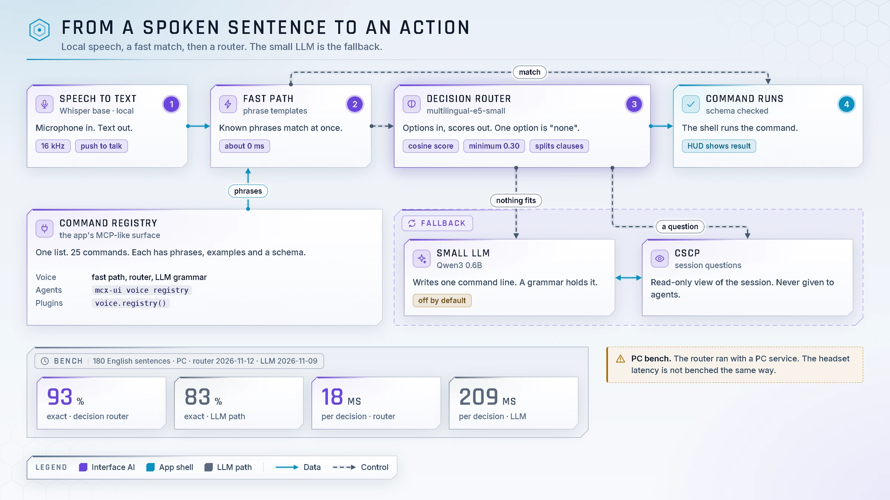

<p align="center"></p>

# MetaCodex

**A coding-agent workstation inside a standalone mixed-reality headset.**

<a href="docs/assets/diagrams/hero-light.webp"><picture><source media="(prefers-color-scheme: dark)" srcset="docs/assets/diagrams/hero-dark.webp"></picture></a><br><sub>Full size: <a href="docs/assets/diagrams/hero-dark.webp">dark</a> · <a href="docs/assets/diagrams/hero-light.webp">light</a></sub>

MetaCodex runs a real Debian Linux system inside one headset app.
You work in spatial panels: terminals, threads, files, git and a web view.
You control them with your hands and your voice.
Local AI models run the interface. An optional local coding model can run agent threads offline.
Coding agents work in the Linux, and they can build native headset apps on the headset itself.

## What is MetaCodex

MetaCodex is a workstation for software work that you wear.
It is one app on a standalone mixed-reality headset.
You do not need a PC, a monitor or a keyboard.

You see your room through the headset.
Your work floats in that room as panels: terminals, agent threads, files, diffs, git and a web view.
You touch the panels with your fingers, or you point at them and pinch.
You talk to the app, and it answers with a voice.

Inside the app there is a full Debian Linux system.
Coding agents work in that Linux system for you.
They read and change code, run builds and tests, and use git.
They can also make native apps for the headset, and the headset installs and runs those apps.

## Productivity in the metacoding era

We call it **metacoding** when you direct coding agents and do not write every line yourself.
In metacoding, your work changes:

- You give goals to several agents at the same time.
- You read their plans, their changes and their results.
- You make decisions: approve, correct, merge or stop.
- You switch fast between many tasks, and you must always know their status.

A laptop screen is too small for this work.
Agent threads, terminals and diffs compete for the same few windows.
MetaCodex gives you the space and the controls that metacoding needs:

| Need | What MetaCodex gives you |
|---|---|
| See many agents at once | Each thread has its own window, and up to six are open at the same time. Drop one window on another to make a group that moves as one. The status of all your work stays in view. |
| Know what an agent did | Ask "give me a recap of the login thread". The app speaks the answer by default. The side bar of a thread window shows a live map of the changed files and their diffs. |
| Run agents in parallel safely | Threads that work in the same folder wait for each other. You can send a waiting turn IN A WORKTREE, so its agent works on its own git branch. A dry run shows merge conflicts before you merge. |
| Control without a keyboard | Hands and voice do the common actions: open, close, switch, find a thread. Only your hands approve. The headset's system keyboard is there for real typing. |
| Close the loop on one device | An agent builds a native app on the headset. You launch it, test it and go back to the thread. One tap sends a picture and the logs back to the agent. |
| Work offline and in private | Local models run the voice interface on the headset. An optional local coding model lets agents work with no network. Keys stay sealed in a vault, and the agents' sign-ins stay inside their own tools. |

MetaCodex does not replace your coding agents.
It is the place where you work with them: a desk that is always with you and as large as your room.

## Contents

- [What is MetaCodex](#what-is-metacodex)
- [Productivity in the metacoding era](#productivity-in-the-metacoding-era)
- [Highlights](#highlights)
- [How it works](#how-it-works)
  - [One app, two processes](#one-app-two-processes)
  - [First start](#first-start)
  - [A real Linux inside the app](#a-real-linux-inside-the-app)
  - [Two AI stacks, two jobs](#two-ai-stacks-two-jobs)
  - [From a spoken sentence to an action](#from-a-spoken-sentence-to-an-action)
  - [How MQH grows](#how-mqh-grows)
  - [Secrets stay sealed](#secrets-stay-sealed)
  - [Native apps built on the headset](#native-apps-built-on-the-headset)
  - [A workspace you can stand in](#a-workspace-you-can-stand-in)
- [Security and privacy](#security-and-privacy)
- [Repository layout](#repository-layout)
- [Documentation](#documentation)
- [Build and run](#build-and-run)
- [Testing](#testing)
- [Status and limits](#status-and-limits)
- [License](#license)

## Highlights

The test headset has 6 cores and 7.9 GB RAM.

| What | Value | Context |
|---|---|---|
| APK size | 995 MB | 994,868,919 bytes. It holds the Linux, the AI models and MQH, so the first start downloads nothing. |
| First start | 21 s | A one-time setup from the APK, offline, while a guided tour runs. Measured on the test headset from the shell start to the last setup step. |
| Voice commands in the registry | 34 | Each one has a schema, synonyms, phrases and examples. |
| Thread windows | 6 | Open at the same time. Groups of 2x1, 2x2 or 3x2 move as one window. |
| Agent skills shipped | 49 + 13 | 49 for every project, 6 of them written for MetaCodex. 13 more for native-app projects. |
| Plugins | 2 app examples | A plugin is a project with a fixed kind: an app (its own windows, menu tiles and voice commands), gestures or a behaviour. It runs while the app runs; a thread on its project lets an agent change it. Timers and Calendar ship as examples. |
| Project types | 3 | NATIVE, DEFAULT and RESEARCH. A project made in the app is a git repository. |
| Default gesture | Pinch | Selects, drags and scrolls. No gesture opens or closes a window by default. |
| Dock and wrist menu tiles | 11 | The same tiles in both places. Plugins can add up to 6 more. |
| Text input | System keyboard | Each text field opens the headset's system keyboard. |
| Local coding model | Optional | Runs agent threads on the headset, offline. |

## How it works

### One app, two processes

<a href="docs/assets/diagrams/platform-light.webp"><picture><source media="(prefers-color-scheme: dark)" srcset="docs/assets/diagrams/platform-dark.webp"></picture></a><br><sub>Full size: <a href="docs/assets/diagrams/platform-dark.webp">dark</a> · <a href="docs/assets/diagrams/platform-light.webp">light</a></sub>

- MetaCodex is one Android app with two processes.
- The main process holds the 3D engine, the shell, the terminals and the Java plugins. The headset OS puts it on cores 3-5.
- The `:ai` service process holds MQH, the agent CLIs, the build daemon and the local AI runtime. It runs on cores 0-2.
- Only a separate Android process can reach cores 0-2. Every child process inherits the cpuset of its parent. For this reason the heavy services live in `:ai`.
- The frame loop keeps cores 3-5. The local AI runs with 2 inference threads at `nice 10`.
- At start, the app asks the headset for a sustained high GPU level. It does not trade CPU level for GPU level.
- Each build turns on these rendering options: dynamic foveation, symmetric projection, multiview render regions and late latching.
- Garbage collection is incremental in every build.
- Start-up work, such as building the voice decision model, runs off the main thread. The shell is built in small pieces behind the start splash, with at most 20 ms of main-thread work in a frame.
- Each service listens on `127.0.0.1` only. Every app on the headset can reach loopback, so each service has its own token.

| Port | Service | Token |
|---|---|---|
| 47800 | Control port of the app | Random, new at every launch. |
| 38990 | MQH server | Held in the vault. |
| 38991 | MQH host daemon | None (local). |
| 47810 | Local AI service | Random, new at every start. |
| 47950 | Log sink for built apps | None. |

**Background behaviour.** While `:ai` has child processes, it runs as a foreground service.
This keeps the agents, the local AI and a build alive while a built app is in front.
A build also holds a wake lock.
Android stops a background process whose children use more than 25 % CPU over 5 minutes.
For this reason, when `:ai` has no foreground service, the build daemon pauses a build before it passes 15 %.

The app checks the health of MQH and of the local AI every 5 s. Three missed checks restart the process.

### First start

- The APK carries everything the app needs: the Linux with its tools, the four AI models, MQH and the vectors of the voice's decision model. The first start downloads nothing.
- While the start splash shows, the app asks once for the microphone, spatial data and the headset camera. The install script grants them at install time.
- The very first start lays out what the APK carries, in five steps: the AI models, the local AI service, the Linux, MQH and the voice's decision model. On the test headset this one-time setup took 21 s after the shell was up.
- One small guide card opens after the splash. Its top strip shows the step in plain words, STEP k OF 5, one bar for the whole setup and the line "One-time setup: only on this first start, nothing is downloaded". At the end it says "Setup done in N s" and folds away.
- Until its step is done, a feature is dimmed and shows 🔒. TALK waits for step 5. THREADS and AGENTS wait for step 4. TERMINALS and FILES wait for step 3. A tap gives one short message, nothing else. Every lock lifts by itself, at the latest 5 minutes after the setup began.
- Below the strip, the Whisp gives a short tour: the main menu, the Whisp, moving a window, CONTROL and TALK. Each beat waits for you to do it, and a ring of light marks its target. You can skip a step or the whole tour.
- The setup never runs again. CONTROL > ABOUT > TOUR, or the voice command "start the tour", plays the tour again.
- [docs/ready-on-install.md](docs/ready-on-install.md) has the details and the measured times of each step.

### A real Linux inside the app

<a href="docs/assets/diagrams/userland-light.webp"><picture><source media="(prefers-color-scheme: dark)" srcset="docs/assets/diagrams/userland-dark.webp"></picture></a><br><sub>Full size: <a href="docs/assets/diagrams/userland-dark.webp">dark</a> · <a href="docs/assets/diagrams/userland-light.webp">light</a></sub>

- The Linux is the official Debian 13 arm64 image with Node.js 24, git, Python 3, curl and their dependencies installed. The APK holds it as one archive of 124,780,445 bytes.
- The first start unpacks it. The app never replaces a Linux that is already installed.
- proot runs the image without root. The guest sees user 0, but its processes keep the Android user of the app.
- Android 10 and later forbids `exec()` of files an app writes. For this reason proot and its loader ship as `lib*.so` files. Android unpacks them into the native library folder, where Android allows `exec()`.
- The overlay lays MetaCodex files over the image: the `mcx-*` tools, native app templates, the skills and the licence texts. It is deterministic. The app lays it again only when its hash changes, and it never touches your packages.
- A shared folder, mounted under `/mnt`, links the app and the Linux. The app, the Linux, `adb` and you can read it. It holds the tokens, plugins, scripts and captures.
- Projects live in the Linux, in `/root/metacodex-projects/`. There is one folder for each type: `native`, `default` and `research`. A project made in the app is a git repository.
- The vault is never mounted into the Linux.
- Every Linux process gets the time zone of the headset, so commit times are local.
- The compiler toolchain for native apps is not in the APK. `mcx-setup quest` installs it when the first native app needs it, or from SYSTEM > TOOLS. A checksum pins every download.

**Processes and threads across the boundary**

| Chain | Forked by | Cores |
|---|---|---|
| Terminal: app, `libmcxpty` fork, proot, bash, your command | Main process | 3-5 |
| MQH: app, `startService`, proot, `mqh-run`, Node.js, agent CLIs, build daemon | `:ai` service | 0-2 |
| Local AI runtime: app, `startService`, runtime executable | `:ai` service | 0-2 |
| `mcx-app build` typed in a terminal: shell, socket, build daemon | `:ai` service | 0-2 |

- Each terminal is one process tree. A small C library does `vfork()`, `setsid` and `execve` on a pty. The engine calls it through P/Invoke.
- Each terminal also has two C# threads: `pty-read` and `pty-write`. A full pty cannot block a frame, because the main thread only drains a queue.
- The terminal emulator is C# code. It matches a terminal multiplexer on 7 real programs and passes 62 core checks.
- Terminal and userland commands run at `nice 10`. A heavy job, such as a package install, stays on cores 3-5.
- A process forked by the app carries the seccomp filter of the app. Under proot it carries two filters: the app and proot.
- The only ways across the process boundary are the Android service intent, loopback HTTP, the shared folder and the build socket.

### Two AI stacks, two jobs

<a href="docs/assets/diagrams/ai-stacks-light.webp"><picture><source media="(prefers-color-scheme: dark)" srcset="docs/assets/diagrams/ai-stacks-dark.webp"></picture></a><br><sub>Full size: <a href="docs/assets/diagrams/ai-stacks-dark.webp">dark</a> · <a href="docs/assets/diagrams/ai-stacks-light.webp">light</a></sub>

MetaCodex has two AI stacks. They do different jobs and never merge.

| | Interface AI | Coding agents |
|---|---|---|
| Job | Runs the interface: opens panels, changes settings, answers questions about your workbench. | Writes code, runs commands and edits files in your projects. |
| Where it runs | On the headset, in the `:ai` process. | Agent CLIs, started by MQH inside the Linux. The local coding model runs in the `:ai` process. |
| Models | Four local models. Nothing leaves the headset. | The model of each agent CLI, in the cloud, under your own account. Or the optional local coding model, on the headset. |
| How it acts | Through the command registry. | Through tools, files and git in a project folder. |
| Sees the session context | Yes (CSCP). | No. The app gives it to no agent. |

- The interface AI never writes code. MQH never drives the interface.
- An agent can still use the control-port tools on purpose. Those tools go through the same command registry and its rules.
- Skills teach an agent how to use these tools.

#### Local models

The four model files ship in the APK, about 650 MiB in total. The first start copies them into place, and a SHA-256 pins each file. The local coding model is a separate, optional download in AGENTS > LOCAL CODER.

| Role | Model | Size | Licence |
|---|---|---|---|
| Speech-to-text | Whisper base, multilingual (q8_0) | 78 MiB | MIT |
| Decision model | multilingual-e5-small, 118M parameters (q8_0) | 126 MiB | MIT |
| Language model | Qwen3 0.6B (q4_0) | 364 MiB | Apache-2.0 |
| Text-to-speech | Diffusion model with 10 voices (q4_0) | 81 MiB | Responsible-AI licence with use restrictions |
| Local coding model (optional) | Qwen2.5-Coder 0.5B Instruct (q4_0) | 409 MiB | Apache-2.0 |

- All four models run on the CPU with 2 threads at `nice 10`. A GPU test was slower for the language model, so the models stay on the CPU. The local coding model also runs on the CPU.
- Idle models unload: speech-to-text after 10 min, the language model and the voice after 15 min. The decision model stays loaded.
- While the local coding model works, the voice models unload. They load again at their next use.
- The runtime exposes HTTP APIs on loopback, in chat-completions, Responses and Messages styles. In the Linux, `mcx-ai` uses the chat-completions API.
- In NEW THREAD, the local model is the first row of the model list. It is marked LOCAL and never becomes the default.

#### The command registry

The command registry is the MCP-like surface of the app.
Everything you can do in the app is a registered command.
Voice, the local language model, agents and plugins read the same entries.

- The shell registers 34 commands, for example `open_panel`, `set_setting`, `find_thread`, `archive_thread` and `switch_workspace`. Plugins and Lua scripts can add more.
- Each command has a name, a JSON schema, synonyms, phrase templates, examples and flags.
- Voice is English only. Speech-to-text, spoken replies and all command phrases use English.
- A lint check rejects a weak command. The self-test fails on any warning.
- A disabled or deleted plugin loses its commands at once.
- From the Linux, `mcx-ui voice registry` returns every enabled command as JSON.

#### Session context

The core session context protocol (CSCP) lets you ask questions instead of only telling it what to do.
Examples: "Is this build stuck?" and "What did this thread achieve?".

- It collects focus, threads, pending approvals, processes, tools, plugins and events. Events stay for 3 hours at most.
- It does not record small UI events, such as the Whisp's callouts, or what you ask it.
- It answers from exact facts first. Only then does the local language model phrase a short recap.
- It is read-only. It never approves a command and never calls a command "safe". It lists the risks, and you decide.

### From a spoken sentence to an action

<a href="docs/assets/diagrams/voice-path-light.webp"><picture><source media="(prefers-color-scheme: dark)" srcset="docs/assets/diagrams/voice-path-dark.webp"></picture></a><br><sub>Full size: <a href="docs/assets/diagrams/voice-path-dark.webp">dark</a> · <a href="docs/assets/diagrams/voice-path-light.webp">light</a></sub>

Most commands run without the language model.

1. You push to talk, or you say "Hey Whisp" (on by default; CONTROL > VOICE turns it off). The microphone records 16 kHz mono and stops 0.7 s after you stop speaking. A clip lasts 12 s at most.
2. Local speech-to-text makes the text. The prompt holds the words of every command, so names are heard right. A misheard word becomes the nearest command word.
3. The fast path matches phrase templates of the enabled commands. It uses no model.
4. The decision model embeds each clause and compares it with example sentences of each command (cosine similarity). It also scores an explicit "none" option for chit-chat.
5. The best command wins. If "none" scores higher, or the best score is below 0.30, the decision model returns no command.
6. The app splits a compound sentence into clauses and runs the commands in order. It reads values from the command schema by rules, so the model generates no text.
7. Verbatim commands, such as typing text, run only when the clause starts with their verb.
8. A question about your workbench goes to the session context (CSCP).
9. The language model is the last step. It is off by default. When you turn it on, it writes one command line that a grammar constrains. The app checks that line against the schema before it runs.
10. The HUD shows the result. Commands marked `speak` answer aloud. Session answers are spoken by default.

A reference such as "reopen it" or "close it" acts on the window you opened or closed last. The app remembers that window for two minutes.

### How MQH grows

<a href="docs/assets/diagrams/mqh-modules-light.webp"><picture><source media="(prefers-color-scheme: dark)" srcset="docs/assets/diagrams/mqh-modules-dark.webp"></picture></a><br><sub>Full size: <a href="docs/assets/diagrams/mqh-modules-dark.webp">dark</a> · <a href="docs/assets/diagrams/mqh-modules-light.webp">light</a></sub>

MQH is the agent harness of the app. It is a trimmed fork of an open-source agent IDE backend.
It runs in the Linux and keeps threads, plugins and skills.
The engine compiles C# ahead of time and cannot load code at run time.
For this reason every extension is Lua, JSON, a Node.js plugin or skill text.
None of them needs an APK rebuild.

| Module | Runs where | Can reach |
|---|---|---|
| Skills | Text that agents read | Nothing by itself. |
| MQH plugins | Node.js in the Linux, TypeScript | The MQH API, project files and processes. |
| Gesture plugins | In the app. Lua detectors and JSON poses. | App actions, panels, terminal input, settings, hands. |
| Lua scripts | In the app, in a soft sandbox | The same actions. No files, no network. |
| App plugins | In the app. Lua with a `plugin.json`. | Their own windows, main menu tiles, voice commands, alarms and saved state. |
| Provider integrations | MQH plugins for agent CLIs | The agent processes MQH starts. |
| Agent views | Fenced blocks in a thread message | Panels: charts, tables, diffs, graphs, a physics stage. |

- **Skills.** 49 skills ship read-only, 6 of them written for MetaCodex. You can add your own. 13 more skills load only in a native-app project.
- **Plugins.** MQH ships only the plugins that MetaCodex uses. Every MQH thread gets the MetaCodex introduction and its skills.
- **Gesture plugins.** A plugin folder holds `plugin.json`, pose files and `main.lua`. The app reloads it within a second. A detector runs at 36 Hz with a budget of 200,000 instructions. Gesture plugins that open or close panels are off by default. GESTURES lists them, and you can turn one on there.
- **Lua scripts.** A script that exceeds its budget stops. The app keeps its frame rate.
- **App plugins.** MetaCodex grows while it runs. An agent writes a plugin, a folder of Lua in the Linux, and it appears at once: its own window drawn with the app's UI kit, its own tile on the DOCK and the wrist menu, voice commands, alarms and saved state. It loads again at every start. Two examples ship: Timers (a focus timer in the tomato style, with alarms) and Calendar (a month grid with entries and reminders). Install them from CONTROL > MQH > PLUGINS (EXAMPLES TO ADD). A plugin has one of three kinds: an app (a window and a menu tile), gestures (named hand poses and detectors) or a behaviour (Lua that reacts to the app).
- **Providers.** One provider speaks the Agent Client Protocol (ACP) to an agent CLI over stdio. The app turns off the folder snapshots of one agent CLI, because they stall its threads.
- **Review.** When an agent changes a plugin, gesture, script or voice command, it shows the change and asks for your OK first.
- **Proof.** A fresh agent writes a working gesture plugin from the skills alone (`tools/agent-plugin-test.sh`).

### Secrets stay sealed

<a href="docs/assets/diagrams/vault-light.webp"><picture><source media="(prefers-color-scheme: dark)" srcset="docs/assets/diagrams/vault-dark.webp"></picture></a><br><sub>Full size: <a href="docs/assets/diagrams/vault-dark.webp">dark</a> · <a href="docs/assets/diagrams/vault-light.webp">light</a></sub>

- One AES-256-GCM key lives in the hardware-backed Android Keystore. Nothing can read the key out of the Keystore. On the test headset it sits in the TEE.
- The associated data of a sealed value holds its name. A value cannot move to another name.
- Sealed values live in a no-backup folder. proot never mounts it.
- If the Keystore is not reachable, the vault locks. There is no fallback key in a file.
- Each secret has a policy: `ask`, `once`, `allow` or `deny`. With `ask`, a dialog in the headset offers ALLOW ONCE, ALWAYS or DENY. No answer in 115 s means deny.
- Every request lands in an access log. The app never shows a value again after you save it.
- `mcx-secret` is the Linux client. `mcx-secret env NAME -- CMD` puts the value in the environment of one command, never on its command line.
- MQH encrypts its stored API keys with an envelope key. The app hands this key out once per session (`once`). MQH keeps it in memory and writes no key file.
- Agent API keys go from the vault into MQH write-only. MQH injects them into the agent processes it starts.
- The git credential helper asks the vault at each use. No `~/.git-credentials` file exists.
- The app never reads, copies or stores the own sign-in tokens of the agent CLIs.

### Native apps built on the headset

<a href="docs/assets/diagrams/native-pipeline-light.webp"><picture><source media="(prefers-color-scheme: dark)" srcset="docs/assets/diagrams/native-pipeline-dark.webp"></picture></a><br><sub>Full size: <a href="docs/assets/diagrams/native-pipeline-dark.webp">dark</a> · <a href="docs/assets/diagrams/native-pipeline-light.webp">light</a></sub>

An agent in a native project builds a real headset app, on the headset, and you test it at once.
Unless you ask for VR or controllers, a new native app uses hands only and mixed reality. A mandatory skill sets this rule for the agent.

> [!WARNING]
> **Before you try native apps, check these four things.**
>
> 1. **Developer mode must be on.** It is also what lets you install MetaCodex, so keep it on. A built app is a sideloaded app like MetaCodex. MetaCodex installs it with Android's own installer, not with `adb`, and its code does not need developer mode for that step. Nobody has tested this with developer mode off. Turn developer mode on in the headset's companion app on your phone.
> 2. **Allow MetaCodex to install apps, once.** At the first install, MetaCodex opens Android's "Install unknown apps" page. Turn on "Allow from this source" for MetaCodex, then come back. `mcx-app install` waits up to 5 minutes for you.
> 3. **Tap INSTALL.** Nothing installs without your tap in the APP READY dialog. Android asks once more at the first install of each app.
> 4. **Keep free storage.** The first use of native apps downloads about 400 MB and the toolchain takes about 2.5 GB.
>
> There is no way to switch on developer mode from inside the app, and the app cannot read its state reliably. If an install fails, check items 1 and 2 first.

Permissions MetaCodex uses:

| Permission | What for | When you see a prompt |
|---|---|---|
| Microphone | Push-to-talk speech to text. | Once, at the first start, while the splash shows. The install script grants it at install time. A refused permission is asked again at the first TALK. |
| Spatial data | The live depth of the room for Ambient Focus. | The same: at the first start, or at install time. Asked again at the first use of Ambient Focus. |
| Headset camera | The passthrough camera, for the Ambient Focus blur. | The same: at the first start, or at install time. Asked again at the first use of Ambient Focus. |
| Hand tracking | Hands as the main input. | No prompt. Granted at install. Hand tracking must be on in the headset settings. |
| Spatial anchors | Anchors in the room, for the app and for the native apps it builds. | No prompt. Granted at install. |
| Install apps | Install the apps an agent builds. | The "Install unknown apps" page, once. Then one tap on INSTALL for each new app. |
| Install updates silently | Update an app that MetaCodex installed, without a new tap. | None. Android decides. |
| Foreground service, wake lock | Keep the agents, the local AI and a build running while a built app is in front, or the headset is off. | None. |
| Wi-Fi and network state | The Wi-Fi signal bars and the offline mark in the wrist menu's core. | None. |

A built app declares its own permissions. `mcx-app verify` lists them. The headset asks for them when the app first uses them.

| Step | Command | What happens |
|---|---|---|
| Check | `mcx-app check` | Syntax and type check only. |
| Build | `mcx-app build` | Compile, link, package and sign. One job at a time, at `nice 10`, on cores 0-2. |
| Verify | `mcx-app verify` | Static checks of the APK: symbols, permissions, features, devices, app menu. |
| Install | `mcx-app install` | You tap INSTALL in the APP READY dialog. |
| Launch | `mcx-app launch` | You tap LAUNCH. The app starts with a launch id. |
| Return | Built-in app menu | Back, or Report with a screenshot and 60 log lines. |

- The toolchain is a community arm64 build of the Android NDK, with the OpenXR headers and loader. The `mcx_xr` layer adds camera passthrough, depth, hands, controllers, anchors and a menu.
- A built-in signer signs the APK. One key signs every app. An update of an app that MetaCodex installed asks nothing.
- Nothing installs for the first time or launches without your tap. This holds in every approval mode.
- A launch id (128 bits) goes only to the app it names. A return counts only with that id and the right sender package.
- Back brings the launching thread forward. Report attaches the screenshot and the log to that thread and drafts "Feedback on ...".
- The memory guard makes a build wait below 900 MB free and stop a tool below 450 MB.
- In a native project, the app lives in the project folder.
- Evidence levels in the project docs: compiles, builds on the headset, offered on the headset, ran on the headset.

### A workspace you can stand in

<a href="docs/assets/diagrams/spatial-ui-light.webp"><picture><source media="(prefers-color-scheme: dark)" srcset="docs/assets/diagrams/spatial-ui-dark.webp"></picture></a><br><sub>Full size: <a href="docs/assets/diagrams/spatial-ui-dark.webp">dark</a> · <a href="docs/assets/diagrams/spatial-ui-light.webp">light</a></sub>

- Camera passthrough shows your room. The panels float in it, curved around you.
- One shader draws a whole panel as one mesh with one draw call. The GPU bends the panel, so text that changes every frame bends with it.
- The UI shader reads precomputed noise and lattice textures, and it stops early where it adds nothing.
- Panel frames look like carved stone armour, and buttons look like carved slate. Both have energy channels. The wrist menu's glass follows the panel opacity setting.
- A start splash shows a transparent logo a metre in front of you, at eye level. It breaks up into light after a few seconds.
- Each text field opens the headset's system keyboard. KEYS opens it for the terminal.
- The Whisp is a small orb of light that floats near you, up to the right of your view. Its quick actions are four plain squares: TALK, SPEAK, PLACE and LOG. It casts windows in and out, shows messages as callouts, and speaks status answers and thread alerts.
- Its light shows its state: calm cyan when idle, gold while it listens, violet while it thinks, pulses and ripples while it speaks, an amber heartbeat while a thread waits for your answer, dim steel while the first start keeps the voice locked. Gold motes mean unread messages.
- The Whisp moves aside from the window you look at. It holds still while it shows a callout or its menu, or while it listens, thinks or speaks. If you turn more than 70 degrees away from it, it follows you.
- A new window opens where you look, its middle just below eye level, turned to you. It never covers another window, the DOCK, or the Whisp's menu and messages. With depth on, it opens at least 8 cm in front of real surfaces.
- A window that you open from another window opens beside it. A window that you open again comes back where you left it, when that place is still in view and free.
- When the view is full, a window opens a little further away, or at the nearest free place round you. The Whisp then points to it.
- The Whisp casts each window: corner brackets lock on and a line of light sweeps across it in 0.35 s. Closing runs the line back in 0.22 s.
- Layouts: FIXED panels stay in the world. FLOAT panels sit on an invisible cylinder that follows your body. The cylinder moves only past a dead zone of 0.30 m, so a small step does not move it. A TURN bar turns the cylinder. No gesture turns it. Named layouts save the open panels.
- Recenter keeps the layout. Every window turns with you, so each keeps its place relative to the others.
- The main menu is the wrist menu, or the DOCK if you choose it in CONTROL > DISPLAY. The wrist menu opens when you look at your left wrist and touch it with your right index finger. Both show the same 11 tiles, plus the tiles of app plugins.
- Hand tracking drives everything: you point the hand ray and pinch. The pinch selects, drags and scrolls. To move a window, you pinch its title bar or the band just above it. The wrist menu and the Whisp also take a touch of the fingertip. No gesture opens or closes a window by default. A pose fires only after you hold it for 2 s in a row. One pose is bound by default: the V (index and middle finger up) turns Ambient Focus on or off. Taps, such as a clap or a swipe, fire at once. A binding never fires while that hand is on a window. Built-in gestures are pinch, grab, point, open, palm-up and clap.
- Ambient Focus keeps a dome of your room visible. The blur covers the whole room at once, using the colours of the room that the camera has seen. A sharpened depth map keeps real people and objects in front of the panels.
- Depth and camera stay on for 60 s after nothing needs them. Voice does not stop the camera. Its frames are not used while speech is turned into text.
- THREADS groups threads by project type: NATIVE, DEFAULT and RESEARCH. A new thread is named from its first message. + PROJECT asks for a type, then a name.
- On NEW THREAD, START opens a draft. Nothing is made until you send the first message.
- CONTROL has a rail of pages beside its window. The rail is as tall as the window.
- A thread view shows the agent chat, its work, approvals, a status line and a side bar with changes, files and git. The side bar builds its list of changes off the main thread.
- Up to 6 thread windows are open at the same time. Each one has its own chat, composer and approvals. The large ✕ at the top right closes one window; the thread stays.
- Drop a thread window on another one to make a group: a grid of 2x1, 2x2 or 3x2 that moves and resizes as one window. Threads of one project join the same group by themselves. Drag a window out of the group to set it free. The side bar of a grouped window opens beside the group.
- When another thread works in the same folder, a new turn waits. SEND NOW starts it in the shared folder. IN A WORKTREE sends it with an instruction to work in a git worktree on its own branch. CANCEL lets it wait.
- ARCHIVE… and DELETE… at the top of a thread window act on its thread, after a question. THREADS > ARCHIVED lists the archived threads; RESTORE brings one back.

## Security and privacy

- **Local tokens.** Every local service has its own token (see [One app, two processes](#one-app-two-processes)). The control port compares in constant time.
- **No remote access in MQH.** It has no cloud account, no tunnel, no telemetry and no self-update. Its API binds to `127.0.0.1`.
- **User-triggered traffic only.** The first start downloads nothing. The agent CLIs talk to their providers under your account. The skills registry proxy contacts a public skills site. The downloads that you ask for (agent CLIs, the native toolchain, the local coding model, packages) reach public hosts.
- **Local AI is private.** Voice, session answers and command decisions use on-device models. Agent threads use cloud models, unless you choose the local coding model.
- **Sign-in pages stay out of the app web view.** Known sign-in hosts and paths open in the headset system browser. The web view keeps cookies, so this keeps accounts out of MetaCodex.
- **Launch on tap.** No app installs or launches without your tap. See [Native apps](#native-apps-built-on-the-headset).
- **Sealed secrets.** See [Secrets stay sealed](#secrets-stay-sealed).
- **Agent limits.** Each thread has a permission mode: EDITS, AUTO or FULL. EDITS asks before commands. FULL never asks. Approvals show in the headset. A voice command never approves.
- **No third-party marks.** The app shows no third-party logos, and the engine's own start logo is off.
- **Not claimed.**
  - No sandbox separates agents from the files of the Linux. They share one Android user.
  - A debuggable APK lets anyone with `adb` use the Keystore key of the app. Make a release build before you store real keys.
  - This build declares the permission to install packages. A store build must not.

## Repository layout

| Path | What | Language |
|---|---|---|
| App project folder | The headset app: shell, UI, hands, terminal, voice, vault, Java plugins. See [docs/DEVELOPMENT.md](docs/DEVELOPMENT.md). | C#, Java |
| `mqh/` | MQH, the agent harness: server, host daemon, CLI, plugins. | TypeScript, Node.js |
| Folder of the local AI service | The JavaScript service for speech, language, voice, decision and coding models. See [docs/DEVELOPMENT.md](docs/DEVELOPMENT.md). | JavaScript |
| `userland/` | Fetch scripts for proot and Debian, the overlay, bundled skills, the MQH start script. | shell, Python |
| `native/` | `pty/` (the pty library), `xr/` (the native app layer), templates, examples, native-app skills, the Runner (a host app that reloads a module). | C, C++ |
| `tests/` | Terminal emulator, side bar and voice effect tests. | C# |
| `tools/` | Compile check, batch scripts, the packed install, device test, control-port client, MQH build, voice bench, release scripts. | shell, Python |
| `docs/` | Design documents, licence inventory, diagrams. | Markdown |

The repository holds neither the Debian layer nor the model files.
`userland/fetch-rootfs.sh` downloads the 30 MB Debian layer and checks its SHA-256.
`tools/userland-image.sh` turns it into the ready Linux of the APK.
`tools/local-ai-models-pack.sh` checks the four model files against their SHA-256 and packs them. It takes them from a folder of verified downloads (`MCX_MODELS_DIR`).

## Documentation

| Document | Content |
|---|---|
| [docs/DEVELOPMENT.md](docs/DEVELOPMENT.md) | Commands, build stack, real names, folder map, dev loop, test suites, guards. |
| [docs/ready-on-install.md](docs/ready-on-install.md) | What the APK carries, the first start (the guide card, the locks, the tour), its measured times, the release folder. |
| [docs/perf.md](docs/perf.md) | Frame rate: rendering options, GPU level, main-thread costs, measured numbers. |
| [docs/ui.md](docs/ui.md) | Spatial UI: style, the Whisp, windows, placement, hands, gestures, layouts, Ambient Focus. |
| [docs/control-center.md](docs/control-center.md) | CONTROL and the main menu. |
| [docs/scripting.md](docs/scripting.md) | Lua scripts and app plugins: their windows, menu tiles and API. |
| [docs/thread-view.md](docs/thread-view.md) | Thread windows: the chat, the message box, groups, held turns, archive. |
| [docs/thread-sidebar.md](docs/thread-sidebar.md) | The side bar of a thread window: changes, files, git. |
| [docs/workspaces.md](docs/workspaces.md) | Several threads in one project, without clashes. |
| [docs/voice.md](docs/voice.md) | The voice path, the command registry, the decision model, spoken replies. |
| [docs/local-ai.md](docs/local-ai.md) | The local AI service: its process, cores, API and frame-rate rules. |
| [docs/local-coder.md](docs/local-coder.md) | The local coding model for agent threads. |
| [docs/session-context.md](docs/session-context.md) | The session context (CSCP). |
| [docs/mqh.md](docs/mqh.md) | The agent harness. |
| [docs/mqh-spatial.md](docs/mqh-spatial.md) | The `spatial.json` format of plugin panels. |
| [docs/secrets.md](docs/secrets.md) | The vault and the threat model. |
| [docs/native-build-and-install.md](docs/native-build-and-install.md) | The native app pipeline: build, install, launch, return. |
| [docs/TEST_CHECKLIST.md](docs/TEST_CHECKLIST.md) | What to test on the headset, by area. |
| [docs/LICENSES.md](docs/LICENSES.md) | Licence inventory of every third-party part. |

## Build and run

You need a Linux shell, `adb`, and the editor version of the app project.
The version is in `ProjectSettings/ProjectVersion.txt` inside the app project folder.

1. Make the generated parts of the APK. Each step is needed again only when its sources change:

   ```bash
   userland/fetch-proot.sh && userland/fetch-rootfs.sh && native/pty/build.sh
   tools/userland-image.sh                         # the ready Linux: Debian, Node.js, base packages
   tools/local-ai-bundle.sh                        # the local AI runtime
   tools/local-ai-models-pack.sh                   # the four AI models
   tools/mqh-build.sh all && tools/mqh-bundle.sh   # MQH for the Linux of the headset
   python3 -I userland/build-overlay.py            # the overlay
   ```

2. Make the vectors of the decision model, after a change to the voice commands. The development AI service runs on the PC for this step:

   ```bash
   tools/local-ai-dev.sh pc start && MCX_UITEST_ONLY=voicedecide tools/unity-batch.sh BatchUiTest && tools/local-ai-dev.sh pc stop
   ```

3. Check that the C# code compiles without the editor:

   ```bash
   tools/cscheck.sh
   ```

4. Build the APK with `tools/unity-batch.sh BatchBuild`.
   `tools/release/make-release.sh` puts the APK, the install scripts and `INSTALL.md` into `release/`.
   `tools/release/install-metacodex.sh` installs the APK over USB and grants its permissions.
   [docs/DEVELOPMENT.md](docs/DEVELOPMENT.md) has the other commands.

## Testing

| Command | Time | What it checks |
|---|---|---|
| `tests/terminal/run-core-tests.sh` | about 10 s | The terminal emulator against a terminal multiplexer, and the archive extractor. No editor. |
| `tools/cscheck.sh` | about 10 s | A compile check with the editor and device defines. No editor. |
| `tests/sidebar/run-sidebar-tests.sh` | not timed | The side bar logic. |
| `tests/voicefx/run-voicefx-tests.sh` | not timed | The voice effect. |
| `tests/plugins/run-plugin-tests.sh --examples` | not timed | App plugins on the real script host with a fake app: load, tiles, every button, three hours of clock, voice lint, restart, unload. No editor. |
| `python3 tools/check-native-skills.py` | not timed | Every command, flag, path and code block in the native-app skills. |
| `python3 tools/comments-only-check.py <git-ref>` | seconds | That a change to C# files touched only comments and whitespace. |

- The headless editor runs a UI self-test in 52 named sections. `MCX_UITEST_ONLY` picks some of them. It needs 3 GB of free memory. See [docs/DEVELOPMENT.md](docs/DEVELOPMENT.md).
- MQH has its own type check and tests in `mqh/`. The workspace guard plugin has its own test files.
- [docs/TEST_CHECKLIST.md](docs/TEST_CHECKLIST.md) lists what to test on the headset, by area.

## Status and limits

This README describes MetaCodex 0.7.19 (versionCode 26).

**Not built**

- **Plugin panels.** The `spatial.json` format, the server route and the scaffold exist. The app has no renderer, and no shipped plugin has a panel. Gesture plugins and Lua scripts are the working path.
- **One agent CLI runs only in a terminal.** MQH threads work with two of the three supported agent CLIs.
- **MQH tools in the command registry**, and a "point and say" prompt to an agent.
- **Runner.** A native host app loads a module and reloads it, so a change needs no APK build. It works, but classic native apps are the default.

**Not verified on the headset**

- The staged start, the guide card, the Whisp's body and the app plugins have no headset run yet. Their checks are in the device checklist.
- The effect of the foreground service and of the build wake lock while a built app is in front.
- REPORT from a built app back to its thread. BACK works on the headset.
- The depth view of the Night Vision example. Built apps with passthrough run on the headset. The camera, depth, hand and controller features of the native layer build there, but their runtime is not verified.
- The speed of the local coding model. A local coding thread dropped frames badly in a headset test.
- A headset benchmark of the decision model.
- Many lines of the device checklist ([docs/TEST_CHECKLIST.md](docs/TEST_CHECKLIST.md)).
- Some Editor self-test checks fail, for example the Whisp's timing while it casts a window.

**Known limits**

- Memory grows after repeated app switches. Android's low-memory killer stopped `:ai` twice in one test.
- The app polls MQH over HTTP. There is no WebSocket.
- While the Whisp's menu is open, the app does not poll the thread list. Answers about running threads may be stale then.
- The app saves the session context in a file in the shared folder (`session-context.jsonl`). Everything in the Linux can read it. The app sends it to no agent.
- Agents and the Linux share one Android user. There is no sandbox between them.
- After a crash of a built app, MetaCodex cannot come forward by itself. Open it from the headset's app list.
- Hand tracking is the only pointing input in the shell. There is no controller mapping.
- The text-to-speech model has use restrictions that apply to users.
- The app is not store-ready. It declares the permission to install packages.
- A network is needed only for what you add: agent CLIs, the native toolchain, the local coding model and packages.

## License

The code of MetaCodex is MIT. See [LICENSE](LICENSE).

Third-party components keep their own licences.
Some of them have copyleft terms and ship as separate binaries.
One model licence has use restrictions.
[docs/LICENSES.md](docs/LICENSES.md) lists every part with its licence, source and duties.
It covers what ships in the APK, what the app downloads, what the repository holds and the open gaps.
It also lists the Debian packages and the runtime packages.
A copy ships on the headset in `/usr/share/doc/metacodex/`.
