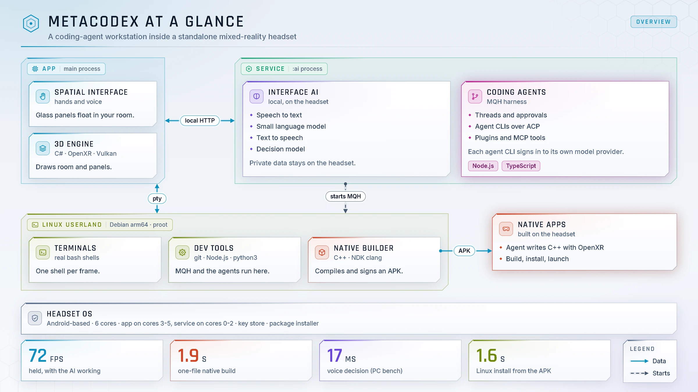
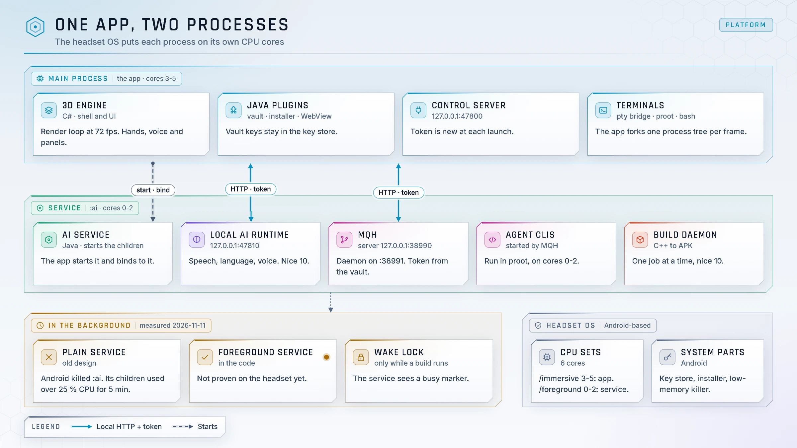
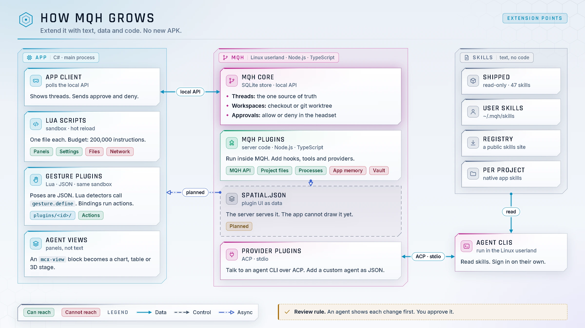
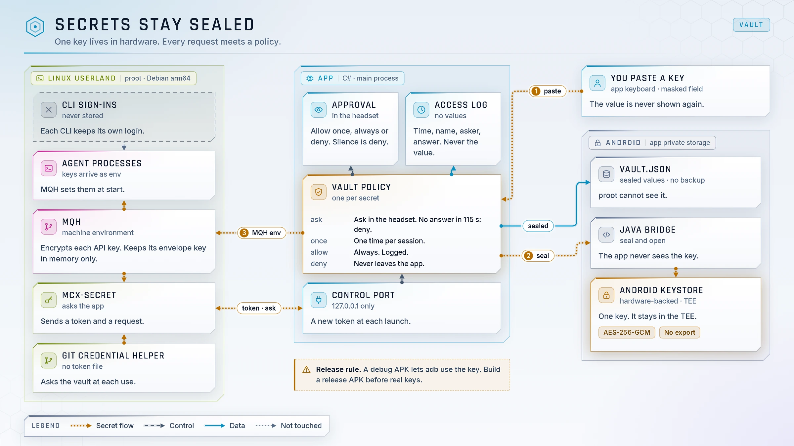
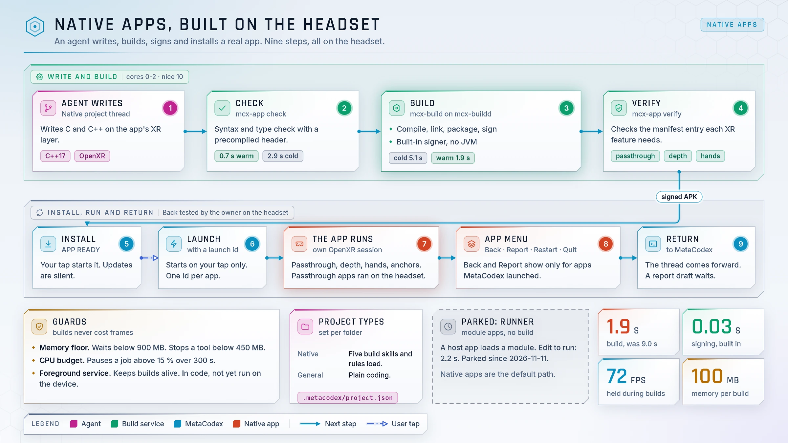

<p align="center"></p>

# MetaCodex

**A coding-agent workstation inside a standalone mixed-reality headset.**

<picture><source media="(prefers-color-scheme: dark)" srcset="docs/assets/diagrams/hero-dark.webp"></picture>

MetaCodex runs a real Debian Linux system inside one headset app.
You work in spatial panels: terminals, threads, files, git and a web view.
You control them with your hands and your voice.
Local AI models run the interface.
Coding agents work in the Linux, and they can build native headset apps on the headset itself.

## What is MetaCodex

MetaCodex is a workstation for software work that you wear.
It is one app on a standalone mixed-reality headset.
You do not need a PC, a monitor or a keyboard.

You see your room through the headset.
Your work floats in that room as panels: terminals, agent threads, files, diffs, git and a web view.
You touch the panels with your fingers, or you point at them and pinch.
You talk to the app, and it answers with a voice.

Inside the app there is a full Debian Linux system.
Coding agents work in that Linux system for you.
They read and change code, run builds and tests, and use git.
They can also make native apps for the headset, and the headset installs and runs those apps.

## Productivity in the metacoding era

We call it **metacoding** when you direct coding agents and do not write every line yourself.
In metacoding, your work changes:

- You give goals to several agents at the same time.
- You read their plans, their changes and their results.
- You make decisions: approve, correct, merge or stop.
- You switch fast between many tasks, and you must always know their status.

A laptop screen is too small for this work.
Agent threads, terminals and diffs compete for the same few windows.
MetaCodex gives you the space and the controls that metacoding needs:

| Need | What MetaCodex gives you |
|---|---|
| See many agents at once | Each thread has its own panel. The panels stand around you in the room, so the status of all your work is in view. |
| Know what an agent did | Ask "give me a recap of the login thread". A spoken answer starts in seconds. The thread panel shows a live map of the changed files and their diffs. |
| Run agents in parallel safely | Threads that work in the same folder wait for each other. A new thread can get its own git worktree. A dry run shows merge conflicts before you merge. |
| Control without a keyboard | Hands and voice do the common actions: open, close, switch, approve, find a thread. A keyboard on the table is there for real typing. |
| Close the loop on one device | An agent builds a native app on the headset. You launch it, test it and go back to the thread. One tap sends a picture and the logs back to the agent. |
| Work offline and in private | Local models run the voice interface on the headset. An optional local coding model lets agents work with no network. Keys stay sealed in a vault, and the agents' sign-ins stay inside their own tools. |

MetaCodex does not replace your coding agents.
It is the place where you work with them: a desk that is always with you and as large as your room.

## Contents

- [What is MetaCodex](#what-is-metacodex)
- [Productivity in the metacoding era](#productivity-in-the-metacoding-era)
- [Highlights](#highlights)
- [How it works](#how-it-works)
  - [One app, two processes](#one-app-two-processes)
  - [A real Linux inside the app](#a-real-linux-inside-the-app)
  - [Two AI stacks, two jobs](#two-ai-stacks-two-jobs)
  - [From a spoken sentence to an action](#from-a-spoken-sentence-to-an-action)
  - [How MQH grows](#how-mqh-grows)
  - [Secrets stay sealed](#secrets-stay-sealed)
  - [Native apps built on the headset](#native-apps-built-on-the-headset)
  - [A workspace you can stand in](#a-workspace-you-can-stand-in)
- [Security and privacy](#security-and-privacy)
- [Performance](#performance)
- [Repository layout](#repository-layout)
- [Documentation](#documentation)
- [Build and run](#build-and-run)
- [Testing](#testing)
- [Status and limits](#status-and-limits)
- [License](#license)

## Highlights

All values come from one standalone headset (Android 14, 6 cores, 7.9 GB RAM), unless the context says PC.

| What | Value | Context |
|---|---|---|
| Frame rate with local AI running | 72 fps | During the speech, language model and voice stages. 0 to 2 stale frames per stage. |
| Frame rate during builds | 72.5 fps average, 70 minimum | Five builds in a row on cores 0-2. |
| Linux install from the APK | 1.6 s | 2,677 files, first launch. |
| MQH ready | about 6 s | The server is up and the host daemon is enrolled. |
| Decision model accuracy | 93 % | 180 English test sentences, exact match, PC bench, 2026-11-12. On the same sentences, the language model path scored 83 % (2026-11-09). |
| Decision latency | 18 ms | Median per decision, PC bench, 2026-11-12. The language model path needed 209 ms (2026-11-09). |
| Speech-to-text | 0.66 to 0.73 s | Per command, on the headset, while the app runs at 72 fps. |
| Rebuild of a native app | 1.9 s | One file changed, on the headset. The first pipeline needed 9.04 s. |
| Syntax check of a native app | 0.7 s | Warm. A cold check takes 2.9 s. |
| Voice commands in the registry | 25 | Each one has a schema, synonyms, phrases and examples. |
| Agent skills shipped | 47 | 4 of them are written for MetaCodex. |
| APK size | 195 MiB | 204,841,243 bytes, build of 2026-11-11. |

## How it works

### One app, two processes

<picture><source media="(prefers-color-scheme: dark)" srcset="docs/assets/diagrams/platform-dark.webp"></picture>

- MetaCodex is one Android app with two processes.
- The main process holds the 3D engine, the shell, the terminals and the Java plugins. The headset OS puts it on cores 3-5.
- The `:ai` service process holds MQH, the agent CLIs, the build daemon and the local AI runtime. It runs on cores 0-2.
- Only a separate Android process can reach cores 0-2. Every child process inherits the cpuset of its parent. For this reason the heavy services live in `:ai`.
- The frame loop keeps cores 3-5. The local AI runs with 2 inference threads at `nice 10`, and the app holds 72 fps.
- Each service listens on `127.0.0.1` only. Every app on the headset can reach loopback, so each service has its own token.

| Port | Service | Token |
|---|---|---|
| 47800 | Control port of the app | Random, new at every launch. |
| 38990 | MQH server | Held in the vault. |
| 38991 | MQH host daemon | None (local). |
| 47810 | Local AI service | Random, new at every start. |
| 47950 | Log sink for built apps | None. |

**Background behaviour.** The test with a built app in front of MetaCodex showed two facts.
Android stopped the idle service after about 65 s. That was the old service, without a foreground notice.
Android also killed `:ai` and its children, because they used more than 25 % CPU over 5 minutes.
The source now makes `:ai` a foreground service while it has children.
It also holds a wake lock while a build runs.
Neither change is proven on the device yet (see [Status and limits](#status-and-limits)).

The app checks the health of MQH and of the local AI every 5 s. Three missed checks restart the process.

### A real Linux inside the app

<picture><source media="(prefers-color-scheme: dark)" srcset="docs/assets/diagrams/userland-dark.webp"></picture>

- The Linux is the official Debian 13 arm64 image. It is 30,214,037 bytes in the APK.
- The app unpacks it on first launch. This takes 1.6 s for 2,677 files.
- proot runs the image without root. The guest sees user 0, but its processes keep the Android user of the app.
- Android 10 and later forbids `exec()` of files an app writes. For this reason proot and its loader ship as `lib*.so` files. Android unpacks them into the native library folder, where Android allows `exec()`.
- The overlay lays MetaCodex files over the image: the `mcx-*` tools, native app templates, 47 skills and the licence texts. It is deterministic. The app lays it again only when its hash changes, and it never touches your packages.
- A shared folder, mounted under `/mnt`, links the app and the Linux. The app, the Linux, `adb` and you can read it. It holds the tokens, plugins, scripts and captures.
- The vault is never mounted into the Linux.
- First use runs `mcx-setup` in the background. It adds Node.js 24 and, for native apps, the compiler toolchain. A checksum pins every download.

**Processes and threads across the boundary**

| Chain | Forked by | Cores |
|---|---|---|
| Terminal: app, `libmcxpty` fork, proot, bash, your command | Main process | 3-5 |
| MQH: app, `startService`, proot, `mqh-run`, Node.js, agent CLIs, build daemon | `:ai` service | 0-2 |
| Local AI runtime: app, `startService`, runtime executable | `:ai` service | 0-2 |
| `mcx-app build` typed in a terminal: shell, socket, build daemon | `:ai` service | 0-2 |

- Each terminal is one process tree. A small C library does `fork()`, `setsid` and `execve` on a pty. The engine calls it through P/Invoke.
- Each terminal also has two C# threads: `pty-read` and `pty-write`. A full pty cannot block a frame, because the main thread only drains a queue.
- The terminal emulator is C# code. It matches a terminal multiplexer on 7 real programs and passes 62 core checks.
- A heavy job in a terminal, such as a package install, stays on cores 3-5. Start it with `nice -n 10`.
- A process forked by the app carries the seccomp filter of the app. Under proot it carries two filters: the app and proot.
- The only ways across the process boundary are the Android service intent, loopback HTTP, the shared folder and the build socket.

### Two AI stacks, two jobs

<picture><source media="(prefers-color-scheme: dark)" srcset="docs/assets/diagrams/ai-stacks-dark.webp"></picture>

MetaCodex has two AI stacks. They do different jobs and never merge.

| | Interface AI | Coding agents |
|---|---|---|
| Job | Runs the interface: opens panels, changes settings, answers questions about your workbench. | Writes code, runs commands and edits files in your projects. |
| Where it runs | On the headset, in the `:ai` process. | Agent CLIs, started by MQH inside the Linux. |
| Models | Four local models. Nothing leaves the headset. | The model of each agent CLI, in the cloud, under your own account. |
| How it acts | Through the command registry. | Through tools, files and git in a project folder. |
| Sees the session context | Yes (CSCP). | No. The app gives it to no agent. |

- The interface AI never writes code. MQH never drives the interface.
- An agent can still use the control-port tools on purpose. Those tools go through the same command registry and its rules.
- Skills teach an agent how to use these tools.

#### Local models

The model files are not in the APK. VOICE > INSTALL MODELS downloads them once, about 650 MiB in total. The app checks the SHA-256 of each file.

| Role | Model | Size | Licence |
|---|---|---|---|
| Speech-to-text | Whisper base, multilingual (q8_0) | 78 MiB | MIT |
| Decision model | multilingual-e5-small, 118M parameters (q8_0) | 126 MiB | MIT |
| Language model | Qwen3 0.6B (q4_0) | 364 MiB | Apache-2.0 |
| Text-to-speech | Diffusion model with 10 voices (q4_0) | 81 MiB | Responsible-AI licence with use restrictions |

- All four models run on the CPU with 2 threads at `nice 10`. A GPU test was slower for the language model (13.8 against 37 tokens/s), so the models stay on the CPU.
- Idle models unload: speech and language model after 30 min, voice after 10 min, decision model after 60 min.
- The runtime exposes a chat-completions style HTTP API on loopback. In the Linux, `mcx-ai` uses it.

#### The command registry

The command registry is the MCP-like surface of the app.
Everything you can do in the app is a registered command.
Voice, the local language model, agents, plugins and the bench read the same entries.

- The shell registers 25 commands, for example `open_panel`, `set_setting`, `find_thread` and `switch_workspace`.
- Each command has a name, a JSON schema, synonyms, phrase templates, examples and flags.
- Voice is English only. Speech-to-text, spoken replies and all command phrases use English.
- A lint check rejects a weak command. The self-test fails on any warning.
- A disabled or deleted plugin loses its commands at once.
- From the Linux, `mcx-ui voice registry` returns every enabled command as JSON.

#### Session context

The core session context protocol (CSCP) lets you ask questions instead of only telling it what to do.
Examples: "Is this build stuck?" and "What did this thread achieve?".

- It collects focus, threads, pending approvals, processes, tools, plugins and events. Events stay for 3 hours at most.
- It answers from exact facts first. Only then does the local language model phrase a short recap.
- It is read-only. It never approves a command and never calls a command "safe". It lists the risks, and you decide.

### From a spoken sentence to an action

<picture><source media="(prefers-color-scheme: dark)" srcset="docs/assets/diagrams/voice-path-dark.webp"></picture>

Most commands run without the language model.

1. You push to talk. The microphone records 16 kHz mono and stops 0.7 s after you stop speaking. A clip lasts 12 s at most.
2. Local speech-to-text makes the text. The prompt holds the words of every command, so names are heard right. A misheard word becomes the nearest command word.
3. The fast path matches phrase templates of the enabled commands. It takes about 0 ms and uses no model.
4. The decision model embeds each clause and compares it with example sentences of each command (cosine similarity). It also scores an explicit "none" option for chit-chat.
5. The best command wins. If "none" scores higher, or the best score is below 0.30, the decision model returns no command.
6. The app splits a compound sentence into clauses and runs the commands in order. It reads values from the command schema by rules, so the model generates no text.
7. Verbatim commands, such as typing text, run only when the clause starts with their verb.
8. A question about your workbench goes to the session context (CSCP).
9. The language model is the last step. It is off by default. When you turn it on, it writes one command line that a grammar constrains. The app checks that line against the schema before it runs.
10. The HUD shows the result. Only commands marked `speak` answer aloud.

| Pipeline (180 English sentences, PC bench) | Exact match | Latency per decision |
|---|---|---|
| Fast path, then decision model (2026-11-12) | 93 % | 18 ms median |
| Fast path, then language model (2026-11-09) | 83 % | 209 ms median |

The 2026-11-09 latency of the language model is the median of that full run.
The PC bench used a PC copy of the AI service.
The repository holds no headset latency for the decision model.

### How MQH grows

<picture><source media="(prefers-color-scheme: dark)" srcset="docs/assets/diagrams/mqh-modules-dark.webp"></picture>

MQH is the agent harness of the app. It is a trimmed fork of an open-source agent IDE backend.
It runs in the Linux and keeps threads, plugins and skills.
The engine compiles C# ahead of time and cannot load code at run time.
For this reason every extension is Lua, JSON, a Node.js plugin or skill text.
None of them needs an APK rebuild.

| Module | Runs where | Can reach |
|---|---|---|
| Skills | Text that agents read | Nothing by itself. |
| MQH plugins | Node.js in the Linux, TypeScript | The MQH API, project files and processes. |
| Gesture plugins | In the app. Lua detectors and JSON poses. | App actions, panels, terminal input, settings, hands. |
| Lua scripts | In the app, in a soft sandbox | The same actions. No files, no network. |
| Provider integrations | MQH plugins for agent CLIs | The agent processes MQH starts. |
| Agent views | Fenced blocks in a thread message | Panels: charts, tables, diffs, graphs, a physics stage. |

- **Skills.** 47 skills ship read-only. You can add your own. Five more skills load only in a native-app project.
- **Gesture plugins.** A plugin folder holds `plugin.json`, pose files and `main.lua`. The app reloads it within a second. A detector runs at 36 Hz with a budget of 200,000 instructions.
- **Lua scripts.** A script that exceeds its budget stops. The app keeps its frame rate.
- **Providers.** One provider speaks the Agent Client Protocol (ACP) to an agent CLI over stdio.
- **Review.** When an agent changes a plugin, gesture, script or voice command, it shows the change and asks for your OK first.
- **Proof.** A fresh agent wrote a working gesture plugin from the skills alone.
- **Planned.** A plugin can describe a panel in `spatial.json`. The server serves it, but the app does not render it yet.

### Secrets stay sealed

<picture><source media="(prefers-color-scheme: dark)" srcset="docs/assets/diagrams/vault-dark.webp"></picture>

- One AES-256-GCM key lives in the hardware-backed Android Keystore. Nothing can read the key out of the Keystore. On the test headset it sits in the TEE.
- The associated data of a sealed value holds its name. A value cannot move to another name.
- Sealed values live in a no-backup folder. proot never mounts it.
- If the Keystore is not reachable, the vault locks. There is no fallback key in a file.
- Each secret has a policy: `ask`, `once`, `allow` or `deny`. With `ask`, a dialog in the headset offers ALLOW ONCE, ALWAYS or DENY. No answer in 115 s means deny.
- Every request lands in an access log. The app never shows a value again after you save it.
- `mcx-secret` is the Linux client. `mcx-secret env NAME -- CMD` puts the value in the environment of one command, never on its command line.
- MQH encrypts its stored API keys with an envelope key. The app hands this key out once per session (`once`). MQH keeps it in memory and writes no key file.
- Agent API keys go from the vault into MQH write-only. MQH injects them into the agent processes it starts.
- The git credential helper asks the vault at each use. No `~/.git-credentials` file exists.
- The app never reads, copies or stores the own sign-in tokens of the agent CLIs.

### Native apps built on the headset

<picture><source media="(prefers-color-scheme: dark)" srcset="docs/assets/diagrams/native-pipeline-dark.webp"></picture>

An agent in a native project builds a real headset app, on the headset, and you test it at once.

| Step | Command | What happens | Time |
|---|---|---|---|
| Check | `mcx-app check` | Syntax and type check only. | 0.7 s warm, 2.9 s cold |
| Build | `mcx-app build` | Compile, link, package and sign. One job at a time, at `nice 10`, on cores 0-2. | 1.9 s for one changed file |
| Verify | `mcx-app verify` | Static checks of the APK: symbols, permissions, features, devices, app menu. | |
| Install | `mcx-app install` | A request. You tap INSTALL in the APP READY dialog. | about 2 s for a silent update |
| Launch | `mcx-app launch` | A request. You tap LAUNCH. The app starts with a launch id. | |
| Return | Built-in app menu | Back, or Report with a screenshot and 60 log lines. | |

- The toolchain is a community arm64 build of the Android NDK, with the OpenXR headers and loader. The `mcx_xr` layer adds camera passthrough, depth, hands, controllers, anchors and a menu.
- A built-in signer signs the APK in 0.03 s. One key signs every app. An update of an app that MetaCodex installed asks nothing.
- Nothing installs for the first time or launches without your tap. This holds in every approval mode.
- A launch id (128 bits) goes only to the app it names. A return counts only with that id and the right sender package.
- Back brings the launching thread forward. Report attaches the screenshot and the log to that thread and drafts "Feedback on ...".
- The memory guard makes a build wait below 900 MB free and stop a tool below 450 MB.
- Evidence levels in the project docs: compiles, builds on the headset, offered on the headset, ran on the headset.

### A workspace you can stand in

<picture><source media="(prefers-color-scheme: dark)" srcset="docs/assets/diagrams/spatial-ui-dark.webp"></picture>

- Camera passthrough shows your room. The panels float in it, curved around you.
- One shader draws a whole panel as one mesh with one draw call. The GPU bends the panel, so text that changes every frame bends with it.
- The orb is a sphere of energy near you. It casts panels in and out, shows recent threads, and shows messages as callouts.
- The orb moves aside from the panel you look at.
- A new panel opens in the free place that costs least: in front of you, below eye level. With depth on, it opens at least 8 cm in front of real surfaces.
- Layouts: FIXED panels stay in the world. FLOAT panels sit on an invisible cylinder that follows you. Named layouts save the open panels.
- The wrist menu opens when you look at your left wrist and touch it with your right index finger. The dock has 12 tiles.
- Hand tracking drives everything: ray and pinch, fingertip poke, fist to move a panel. Built-in gestures are pinch, grab, point, open, palm-up and clap.
- Ambient Focus keeps a dome of your room visible and darkens or blurs the rest. A sharpened depth map keeps real people and objects in front of the panels.
- A thread view shows the agent chat, its work, approvals, a status line and a side bar with changes, files and git.

## Security and privacy

- **Local tokens.** Every local service has its own token (see [One app, two processes](#one-app-two-processes)). The control port compares in constant time.
- **No remote access in MQH.** It has no cloud account, no tunnel, no telemetry and no self-update. Its API binds to `127.0.0.1`.
- **User-triggered traffic only.** The agent CLIs talk to their providers under your account. The skills registry proxy contacts a public skills site. Model and package downloads reach public hosts.
- **Local AI is private.** Voice, session questions and command decisions use on-device models. The coding agents are not local.
- **Sign-in pages stay out of the app web view.** Known sign-in hosts and paths open in the headset system browser. The web view keeps cookies, so this keeps accounts out of MetaCodex.
- **Launch on tap.** No app installs or launches without your tap. See [Native apps](#native-apps-built-on-the-headset).
- **Sealed secrets.** See [Secrets stay sealed](#secrets-stay-sealed).
- **Agent limits.** Each thread has a permission mode: EDITS, AUTO or FULL. EDITS asks before commands. FULL never asks. Approvals show in the headset. A voice command never approves.
- **No third-party marks.** The app shows no third-party logos.
- **Not claimed.**
  - No sandbox separates agents from the files of the Linux. They share one Android user.
  - A debuggable APK lets anyone with `adb` use the Keystore key of the app. Make a release build before you store real keys.
  - This build declares the permission to install packages. A store build must not.

## Performance

All values come from one standalone headset in November 2026, unless the table says PC.
The notes in [native-build-and-install.md](docs/native-build-and-install.md) and [voice.md](docs/voice.md) hold the raw data.

**Frame rate (72 fps target)**

| Load | Result |
|---|---|
| Terminal and shell idle | 72 fps |
| Local AI: speech, language model, voice (2 threads, `nice 10`, cores 0-2) | 72 fps, 0 to 2 stale frames per stage. With 4 threads: 3 stale frames in speech-to-text. |
| 5 builds in a row on cores 0-2 | 72.5 average, 70 minimum. The headset was off the face, kept awake. |

**Local AI latency (2 threads, `nice 10`, cores 0-2, app at 72 fps)**

| Stage | Result |
|---|---|
| Speech-to-text | 0.66 to 0.73 s per command (0.37 to 0.44 s with 4 threads) |
| Language model, one tool call, prefix cached | 1.2 to 2.0 s |
| Language model, first call after load | 4.6 s |
| Language model, first call without the prefix cache | 7.7 to 9 s |
| Text-to-speech | 2.1 to 3.5 s for 1.6 to 3 s of speech |
| Memory (RSS) | speech 0.28 GB, language model 1.1 GB, voice 0.5 GB |

**Voice routing (PC bench, the 180 English sentences, exact match)**

| Date | Fast path, then decision model | Fast path, then language model |
|---|---|---|
| 2026-11-09 | 94 %, 17 ms median | 83 %, 209 ms median |
| 2026-11-11 | 93 %, 20 ms median | not repeated |
| 2026-11-12 (English-only registry) | 93 %, 18 ms median | not repeated |

Since 2026-11-12, the app and the bench are English only. The latencies of 2026-11-09 and 2026-11-11 are medians of runs that also held other sentences.

The bench builds the decision model from 1,373 examples of 17 commands in 16 s.
The honest run removed every bench sentence from the examples. A self-test fails on any copy.
The data is in [tools/voicebench/results](tools/voicebench/results).

**Native build pipeline (headset, app at 72 fps)**

| Stage | Cold | Warm |
|---|---|---|
| Syntax check | 2.9 s | 0.7 s |
| Compile, one file | 4.35 s | 1.7 s |
| Package | 0.52 s | 0.06 s |
| Sign | 0.03 to 0.06 s | 0.03 s |
| Total build | 5.1 s | 1.9 s (0.1 s if nothing changed) |
| First pipeline (full rebuild, JVM signer) | 9.04 s | 9.04 s |

**Start-up and memory**

| What | Result |
|---|---|
| Linux install from the APK | 1.6 s |
| MQH server ready | about 6 s |
| Base Linux setup (apt base and Node.js 24), over `adb`, 2026-11-06 | 43 s |
| Memory free at idle (app, MQH and local AI idle) | 2.0 to 2.1 GB of 7.9 GB |
| Memory cost of one build | about 100 MB |
| Main process after a 1 h session | 4.35 GB PSS |
| Main process after about 6 app switches in 45 min | 5.4 GB PSS. This is an open problem. |

## Repository layout

| Path | What | Language |
|---|---|---|
| App project folder | The headset app: shell, UI, hands, terminal, voice, vault, Java plugins. See [docs/DEVELOPMENT.md](docs/DEVELOPMENT.md). | C#, Java |
| `mqh/` | MQH, the agent harness: server, host daemon, CLI, plugins. | TypeScript, Node.js |
| Folder of the local AI service | The JavaScript service for speech, language, voice and decision models. See [docs/DEVELOPMENT.md](docs/DEVELOPMENT.md). | JavaScript |
| `userland/` | Fetch scripts for proot and Debian, the overlay, bundled skills, the MQH start script. | shell, Python |
| `native/` | `pty/` (the pty library), `xr/` (the native app layer), templates, examples, native-app skills, the parked Runner. | C, C++ |
| `tests/` | Terminal emulator, typing and side bar tests. | C# |
| `tools/` | Compile check, batch scripts, device test, control-port client, MQH build, voice bench. | shell, Python |
| `docs/` | Design documents, licence inventory, diagrams. | Markdown |

The repository does not hold the 30 MB Debian layer.
`userland/fetch-rootfs.sh` downloads it and checks its SHA-256.

## Documentation

| Document | Content |
|---|---|
| [docs/DEVELOPMENT.md](docs/DEVELOPMENT.md) | Commands, build stack, folder names, dev loop, guards. |
| [docs/LICENSES.md](docs/LICENSES.md) | Licence inventory of every third-party part. |
| [docs/ui.md](docs/ui.md) | Spatial UI, hands, gestures, panels. |
| [docs/voice.md](docs/voice.md) | Voice path, models, measurements. |
| [docs/mqh.md](docs/mqh.md) | The agent harness. |
| [docs/secrets.md](docs/secrets.md) | The vault and the threat model. |
| [docs/native-build-and-install.md](docs/native-build-and-install.md) | Native app pipeline, background behaviour, guards. |
| [docs/session-context.md](docs/session-context.md) | The session context. |
| [docs/keyboard.md](docs/keyboard.md) | The table keyboard (under rework). |

## Build and run

You need a Linux shell, `adb`, and the editor version of the app project.
The version is in `ProjectSettings/ProjectVersion.txt` inside the app project folder.

1. Make the generated parts:

   ```bash
   userland/fetch-proot.sh && userland/fetch-rootfs.sh && native/pty/build.sh && python3 -I userland/build-overlay.py
   ```

2. Build MQH and start it in the Linux shell, apart from the headset:

   ```bash
   tools/mqh-build.sh && tools/mqh-dev.sh start
   ```

3. Check that the C# code compiles without the editor:

   ```bash
   tools/cscheck.sh
   ```

4. Build the APK with the batch script, then install it. [docs/DEVELOPMENT.md](docs/DEVELOPMENT.md) has the exact commands.

## Testing

| Command | Time | What it checks |
|---|---|---|
| `tests/terminal/run-core-tests.sh` | about 10 s | The terminal emulator against a terminal multiplexer, and the archive extractor. No editor. |
| `tools/cscheck.sh` | about 10 s | A compile check with the editor and device defines. No editor. |
| `tests/typing/run-typing-tests.sh` | about 15 s | The typing engine of the table keyboard (60 checks). |
| `tests/sidebar/run-sidebar-tests.sh` | not timed | The side bar logic. |
| `python3 tools/check-native-skills.py` | not timed | Every command, flag, path and code block in the native-app skills. |

- The headless editor runs a UI self-test with about 340 checks. It needs 3 GB of free memory. See [docs/DEVELOPMENT.md](docs/DEVELOPMENT.md).
- The MQH type check passes (61/61). The workspace guard plugin has 35 tests.
- [docs/DEVELOPMENT.md](docs/DEVELOPMENT.md) describes the voice bench.
- [docs/TEST_CHECKLIST.md](docs/TEST_CHECKLIST.md) lists what to test on the headset. Sections 25 to 33 are not ticked yet.

## Status and limits

This README describes the app at version 0.7.16, as of 2026-11-12.

**Under rework or not built**

- **Table keyboard.** It is under rework. The owner reports it unusable on the device. Nobody has measured it with a person. Its error rates come from a simulated typist, so this README does not quote them.
- **Plugin panels.** The `spatial.json` format, the server route and the scaffold exist. The app has no renderer, and no shipped plugin has a panel. Gesture plugins and Lua scripts are the working path.
- **One agent CLI runs in a terminal.** MQH threads work with two of the three supported agent CLIs. The third runs in a terminal for now.
- **Runner.** The no-build path works. The project has parked it. A native host app loads a module and reloads it in 2.2 s. Classic native apps are the default.
- **Not built.** MQH tools in the command registry. A "point and say" request to an agent. A bridge from MQH to the local AI.

**Not proven on the device**

- The foreground service and the build wake lock are in the source. The newest APK is older than these files.
- Back from a built app to MetaCodex works on the headset (owner test, 2026-11-11). Report to MetaCodex is not confirmed on the headset yet.
- Built apps with passthrough ran on the headset (owner test, 2026-11-11). The Night Vision example builds and passes `verify`. Its depth view is not confirmed in a recorded test.
- Camera passthrough, depth, hand and controller features of the native layer build on the headset. Their runtime proof is pending.
- The decision model has no headset benchmark.
- Many items in the device checklist (control center, orb arcs, side bar, table keyboard) await a test on the headset.

**Known problems and limits**

- Memory grows after repeated app switches: 5.4 GB PSS after about 6 switches. Android's low-memory killer stopped `:ai` twice in that test.
- The app polls MQH over HTTP. There is no WebSocket.
- The app saves the session context in a file in the shared folder (`session-context.jsonl`). Everything in the Linux can read it. The app sends it to no agent.
- Agents and the Linux share one Android user. There is no sandbox between them.
- After a crash of a built app, MetaCodex cannot come forward by itself. Open it from the dock.
- Hand tracking is the only input in the shell. There is no controller mapping.
- The text-to-speech model has use restrictions that apply to users.
- The app is not store-ready. It declares the permission to install packages.
- The headset needs a network for first use: Debian, Node.js, toolchain and model downloads.

## License

The code of MetaCodex is MIT. See [LICENSE](LICENSE).

Third-party components keep their own licences.
Some of them have copyleft terms and ship as separate binaries.
One model licence has use restrictions.
[docs/LICENSES.md](docs/LICENSES.md) lists every part with its licence, source and duties.
It covers what ships in the APK, what the app downloads, what the repository holds and the open gaps.
It also lists the Debian packages and the runtime packages.
A copy ships on the headset in `/usr/share/doc/metacodex/`.
